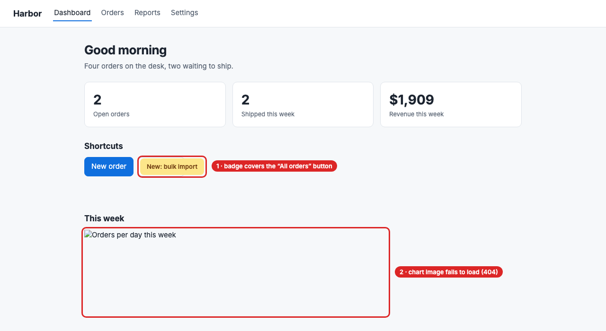

# The SceneScout guide

**SceneScout turns the coding agent you already use into an exploratory tester for any web app.** It drives a real browser, measures every page, and writes a report of what is broken and what could be better, with evidence for each finding and, where there is one, a picture of the page.

[](../../examples/report.md)

<sub>A run against the demo app, which has bugs planted on purpose. Two of its twelve findings are outlined; select the picture to read the whole report.</sub>

## Try it in one command

All it takes is Node 20 or newer and an app you are allowed to test. No account, no API key, no setup:

```bash
npx -y scenescout http://localhost:3000
```

It opens pages in a mode that sends no form, then writes `scenescout-report/report.md` and prints the three issues to look at first. [Start here](Start-here.md#a-first-look-with-nothing-set-up) explains what it does and does not do.

When you want your agent to click, fill forms and compare roles, install it for the agent and ask in plain words:

```bash
npx -y scenescout install          # Claude Code; add --client cursor, vscode, codex, gemini, copilot or windsurf
npx -y scenescout doctor           # every line should be a tick
```

```text
Use SceneScout to test http://localhost:3000
```

The report lands in `.scenescout/report.md`.

## Pick your path

| You are… | You want to… | Read |
|---|---|---|
| **A developer** | Explore the feature you are building, find the request that failed and the file behind it, and get a regression-test skeleton | [Start here](Start-here.md), then [Ways to use it](Ways-to-use-it.md#an-interactive-run) and the [recipe](Recipes.md) closest to your project |
| **In QA or product** | Ask for a test in plain words, read each problem with a picture, and hand over evidence: replays, videos and a test report laid out by your template | [Reading the report](Start-here.md#reading-the-report), the [Claude Desktop extension](Start-here.md#as-a-claude-desktop-extension) (no terminal), then [what it checks](What-it-checks.md) |
| **Looking after CI** | Gate pull requests with no model, run unattended exploration on a schedule, answer `/scenescout qa` comments, and file findings as issues | [Ways to use it](Ways-to-use-it.md#scenescout-check-a-gate-in-ci), the [safety model](Safety-model.md#keys-and-forks-in-ci), then the [configuration reference](Configuration-reference.md) |

Before you point it at anything with real data, read the [safety model](Safety-model.md). If your app needs a sign-in, read [Signing in](Signing-in.md).

## Every page

| Page | What it covers |
|---|---|
| [Start here](Start-here.md) | A first look with no setup, install for each client, a first run against the demo app, reading the report and the live view |
| [Ways to use it](Ways-to-use-it.md) | An interactive run, parallel lanes, `scenescout check` as a CI gate, `scenescout ci` unattended, `/scenescout qa` on pull requests, and `scenescout export` to GitHub or Jira |
| [What it checks](What-it-checks.md) | The checks that run after every action, and every `scout_*` tool |
| [Signing in](Signing-in.md) | Saved logins per role, expiry, the refresh broker, and scripted sign-in for CI |
| [Safety model](Safety-model.md) | The four write modes, what is refused and why, and keys and forks in CI |
| [Recipes](Recipes.md) | Setups for seven kinds of project, from a server-rendered app to a monorepo with preview deployments |
| [Configuration reference](Configuration-reference.md) | Every CLI option, environment variable, GitHub Action input, repository variable and MCP prompt, with defaults |
| [Measuring it](Measuring-it.md) | The benchmark, answer keys, the held-out app and how to read a scorecard |
| [Troubleshooting](Troubleshooting.md) | Symptoms and fixes, upgrading and uninstalling, and common questions |

## Deeper material

The guide explains how to use SceneScout. These stay in the repository:

- [How it works, stage by stage](../how-it-works.md): diagrams of a run, one action, the write policy, findings and lanes.
- [Running it in CI](../ci.md): saved journeys, recording, test reports from templates, and every workflow.
- [The architecture decision records](../adr/README.md): why the rules are what they are.
- [The testing method](../../skills/scenescout/SKILL.md): the text the agent follows.
