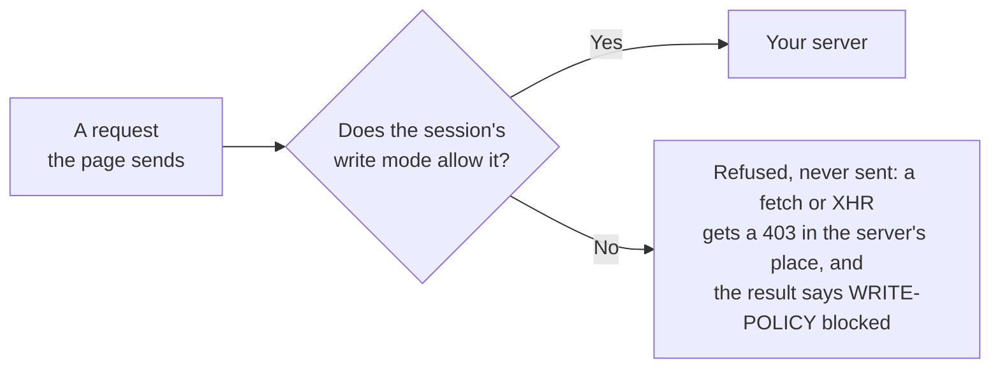

# Safety model

> **Who this is for:** anyone about to point SceneScout at an app with data in it, and anyone setting it up in CI.
>
> **What you will be able to do:** choose a write mode, read a refusal, name what may get through, and keep keys away from pull-request code.

An agent that clicks around an app will, sooner or later, click Delete. SceneScout does not rely on the agent's judgement to prevent that: every request the page sends is checked on the network against the session's write mode, and a request the mode refuses never reaches the server. Why it is enforced there and not in the prompt: [ADR 2](../adr/0002-enforce-the-write-policy-at-the-network-layer.md).

Only test apps you own or are authorised to test.

## The four modes

| Mode | How to ask for it | What leaves the page |
|---|---|---|
| `observe` | `scout_attach {mode: "observe"}`; `--mode observe` for `check`, `ci` and a first look (the first look's default) | `GET`, `HEAD` and `OPTIONS` requests only, plus what a session needs to exist: signing in, signing out and refreshing a token ([what counts](#what-counts-as-signing-in-in-observe)), and any `POST` you name as a read. Signing up, changing or resetting a password and creating users are refused like any other write |
| `read-only` (default) | `scout_attach {mode: "read-only"}`; `--mode read-only` (the default for `check` and `ci`) | Ordinary form submissions (a plain `POST`) go through. `PUT`, `PATCH`, `DELETE`, destructive-looking `POST`s and clicks on destructive-labelled controls (delete, revoke, archive and the like) are refused |
| `safe-write` | `scout_attach {mode: "safe-write"}`; `--mode safe-write` for `ci` | Anything that creates. Changes and deletes only on records this run created, never on data that was there before |
| `destructive` | `scout_attach {mode: "destructive"}`; `--mode destructive --allow-destructive` for `ci` | Everything |

In a chat, the `/scenescout` skill also takes `--observe`, `--read-only`, `--safe-write` and `--allow-destructive` as arguments. Those are words for the agent, which then passes the mode to `scout_attach`; they are not options of the `scenescout` command.

`read-only` blocks the requests that change or remove what is there by name (`PUT`, `PATCH`, `DELETE` and destructive-looking `POST`s); it does not mean nothing is ever created or changed. A contact form, a comment or a sign-up submitted in `read-only` reaches the server and can create a record, and an app that saves an edit with a plain `POST` (a profile, a setting) has that record changed. That is why the method picks `observe` for a remote URL with no source in front of it, where the data is more likely to be real, and moves to `read-only` only when you say form submissions are acceptable there.

`destructive` is for a disposable, seeded environment. The skill and the server's instructions tell the agent never to choose it unless you say so, but over MCP that is an instruction, not a rule: `scout_attach` accepts any mode the agent passes. What holds it back without the agent's cooperation is a [config file](#the-config-file-sets-the-limits-an-agent-cannot-loosen) whose `maxMode` is below it, an open [guided plan](#care-levels-in-a-guided-check) (which never reaches `destructive`), or, in Claude Code with the [mod](Ways-to-use-it.md#the-claude-code-mod), the question it asks before a `scout_attach` that writes. `scenescout ci` needs two options together (`--mode destructive --allow-destructive`) so that a mode value copied from another workflow cannot turn it on.

`scenescout check` accepts only `observe` and `read-only`, and replays saved flows under observe's rule unless `--flow-writes allow` is given. A first look (`scenescout <url>`) is often pointed at a live app, so it runs in `observe` unless `--mode read-only` is given, and accepts no other mode.

## Care levels in a guided check

A guided check (the `scout_intake` form, or a panel building a plan with `scout_guided_plan`) never shows a mode's name. The person chooses a care level in plain words, and each is exactly one mode ([ADR 24](../adr/0024-care-levels-in-plain-words-and-confirmations-only-the-person-gives.md)):

| The person chooses | Mode | Asked to confirm |
|---|---|---|
| Look only (the default) | `observe` | Never |
| May submit forms | `read-only` | When the site is not on this computer (`localhost`, `127.0.0.1` or `::1`, however the browser reads those numbers) |
| May create test data | `safe-write` | Always, with a four-digit code the form shows and the person types back |
| *(not offered)* | `destructive` | Not reachable from a guided check |

Look only lets out what `observe` lets out: page loads, so a search form that only opens a page of results still runs, and a link that changes something just by being opened (an unsubscribe link, say) is followed like any other, unless [destructive page loads are refused](#stricter-judgement-of-destructive-writes).

The confirmation is a form the server shows the person directly (MCP elicitation), started by `scout_guided_confirm`. The agent may call that tool but cannot answer the form, and nothing it passes accepts a plan. A plan is accepted only by the person's yes, and for May create test data only with the code typed back. A form that is declined, closed, fails, or that the client cannot show leaves the plan unaccepted, and the check is offered in Look only.

The server holds this, not the prompt. Once any guided plan has been built, `scout_attach` above `observe` is refused unless it names an accepted plan's `planId`, in no mode above the plan's and on the plan's own site, so leaving the id out is not a way round the confirmation. While a plan is open, an attach that passes `readPosts` or `trustedEmbeds` is refused in any mode, since both let out writes the care level holds back, and `SCENESCOUT_READ_POSTS` is not read, so a server started with it cannot loosen Look only either. Sessions attached before the first plan was built keep the mode they were attached in. A confirmation covers one check: once no session carries the plan (its sessions closed, or attached again without it), the plan must be confirmed again. Plans are held in the server process only and end with it.

A re-check after a fix (`scout_recheck_plan`, the **Re-check after a fix** prompt or the panel's **Check them again**) is a guided plan of its own. Each finding records the mode of the session that filed it, the strictest one when it was filed from several, and a re-check runs in the care level of the strictest mode among the findings it covers, never a looser one; a finding filed before this was recorded counts as found in Look only. Findings found in a looser care level are left for a re-check of their own, and the config file's `maxMode` can lower a re-check's care level but never raise it. A re-check never inherits the original check's confirmation: it has its own `planId`, and a care level that writes asks the person again. A saved check run again (`scout_saved_checks`) is the same: a new plan from the saved choices, confirmed again where its care level needs it.

The person can mark a finding "not a bug" from its card (`scout_feedback`). That is a label, not a deletion: the finding stays in the project's memory with its id, a later check that finds the same problem adds to it rather than filing it again, and the cards and the status pane list it apart. Labels can be listed for a maintainer as candidates for the benchmark's answer key; they never change the key or the dedup by themselves.

### Is it safe to run on my live site?

This is the answer a guided check gives to that question, word for word: on the guided panel's **How it keeps your data safe** screen (also reached from **Is it safe on a live site?** beside the care levels) and wherever the chat answers it.

> Look only, the default, opens pages and signs in. A search still runs, because all it does is open a page of results, but nothing that would save something is sent. Links are opened like any page, so a link that changes something just by being opened, such as an unsubscribe link, is not stopped. It is the safest choice for a live site.
>
> May submit forms sends forms, and presses buttons that send something. What it sends can create a record, or change one that was there, as it would for anyone who sent it; deletes are blocked. On a site that is not on this computer, it asks you first.
>
> May create test data creates the records it needs. What it sends can also change records that were there, but it deletes only what it created. It always asks you first, and is for a test copy only.
>
> Deleting data that was already there is never offered here.
>
> These limits are checked on every request your browser sends, not left to the AI's judgement. A request a care level does not allow never reaches your site. What a care level does allow, a form or a button, does on your site whatever it does for anyone who uses it.
>
> It never asks for your password. When your site needs one, a browser window opens for you to sign in as you normally would.

## The config file sets the limits an agent cannot loosen

Over MCP the agent chooses `scout_attach`'s arguments, including the mode, and an argument wins over the server's environment. So nothing above sets a limit the agent cannot pass. The [config file](Configuration-reference.md#the-config-file) does: a JSON file a team commits as `.scenescout/config.json`, which wins over the environment and over every argument.

- **It caps, and the agent can only ask for less.** `maxMode` is the loosest mode any attach, `check`, `ci` or first look may use; an attach above it is refused before a browser starts, with the file named and the reason. `readPosts` and `trustedEmbeds` become the most an attach may name, `dedup: "rule"` keeps the model judge off, `evidence` caps what a finding's picture may do, `uploads: "fixtures"` keeps `scout_upload` to the files it generates, `projectsRoot` names the folder every project folder must sit inside, and `requireGuidedPlan` holds the guided gate (above) from the server's start, so no attach goes above `observe` without the person's confirmation.
- **The agent cannot choose where it comes from.** The server reads it from the directory it was started in, or from the file `SCENESCOUT_CONFIG` names, once, as it starts. The folder the agent names as `projectPath` may hold a config too, but that one can only tighten: a file the agent could point at is never the lock on its own.
- **`strict` is the one-line setting** for a team that wants every agent to look only: `{"preset": "strict"}` sets `observe` as the most, requires a guided plan, allows no `readPosts` or `trustedEmbeds` from an argument, uploads generated files only, keeps the dedup judge off and keeps finding pictures out of the conversation.
- **No file is today's behaviour,** and a file that is not valid stops the server as it starts rather than being half applied.

What it does not do: it is a file in the repository and on the disk, so an agent with shell access could edit it, or start another server. Edited mid-run, it changes nothing until the server restarts. Review changes to it as you would a CI workflow, and keep the agent's own permissions from writing to it where your client allows that. The write policy's rules themselves are unchanged: the file chooses which mode they run in.

## What a refusal looks like

A refused request is logged as `🛡 WRITE-POLICY blocked` in the tool result. That is the safety net working, not a defect in the app, and it is not filed as one: the errors it causes are counted separately in the report's summary.

Each refused endpoint is named in full, with the explanation, the first time a session meets it. After that it is counted on one line (`3 repeat blocks of 1 known endpoint (POST …/beacon ×3, background)`), so a page that beacons to a monitoring endpoint on every load does not bury each result. Every request is still refused and still counted.

The server never sees a refused request, but the page's own `fetch` or XHR is answered with a `403` in the server's place rather than dropped. The page's handling of a refusal then really runs, which is useful: a page that shows an error is behaving correctly, and a page that claims "Saved" is lying to its user. That second case is reported as `false_success`, a high finding ([ADR 9](../adr/0009-a-refused-write-is-answered-not-dropped.md)). The errors the stand-in causes are not held against the app: a console or page error raised just after a block that reads as that refusal ("Failed to fetch", "Request failed with status code 403", "403 Forbidden", or the stand-in's own message) is left out of the findings, and the same wording with no block just before it is still reported. An alert or live region that appeared after the policy refused one of the current action's requests is marked `(after a write-policy block)` in the snapshot, so a message such as "You do not have permission" is read as the page answering the engine, not as a permission defect.

`scout_request`, which calls the app's API directly as the session, meets the same policy. It carries the session's cookies and the Authorization header the page last sent to the app's own origin, on a read or a write; a header the page sent to another origin, such as an embedded widget's token, is never replayed. When a replay gets 401 while the page's own latest authorised request succeeded, the result says the replayed credential may be stale. A refused call returns `REFUSED by the write policy` instead of a status, because the server was never asked and the result proves nothing either way. Whatever a `scout_request` call meets, its answer is in that tool's result and nowhere else: a probe the server refuses is not reported as an `http_error` or `console_error` of the page the session visits next.

## How a control's label is judged

In `observe` and `read-only` a click is also refused before it happens when the control's own label is destructive (delete, revoke, archive and the like). Only the control's own name counts:

- A button, link, menu item, tab or option is judged by its whole name, however long.
- A dropdown is not judged by its options: a filter offering "All, Create, Delete" can be set to "Create", and choosing "Delete" is refused.
- A row, card, heading or panel is judged by its test id and by the control covering its centre, where a click on it would land. Its text is the record it shows ("Archive Test Widget", "Final sign-off recorded"), so it counts only for a clickable element whose own text is a short command of at most four words and no sentence, such as a clickable box reading "Delete". A heading is never judged by its text. The buttons inside a row are listed and judged on their own.
- Removing a filter chip ("Remove Status: Open filter") drops a condition from the view, so it is allowed. "Remove member" is refused.
- "Sign off" is refused as a command: at the start of a label, or joined to another verb ("Save and sign off"). Elsewhere it is the approval noun ("Needs sign-off", "Manager sign-off") and is allowed.
- "Discard changes", "Discard your edits" and the like drop only what was typed and never sent, so they are allowed. "Discard draft", "Discard record" and a bare "Discard" are refused, and a write the confirm sends is judged on the network like any other: `discard` in a request path is treated as destructive.

## What is a guarantee and what is best effort

A guarantee here is a rule the engine applies to every request or input of its kind, so it holds whatever the agent does or the page is called. Best effort is a judgement about meaning (is this `POST` a delete? is this path a sign-in?) made by matching names, which an app can defeat by naming things differently. Each row names the module that holds the rule, so it can be checked against the code; the rules in those modules are table-tested in `policy-test` and the browser behaviour in the smoke suites.

What each mode does with each kind of request, on the network:

| Request | `observe` | `read-only` | `safe-write` | `destructive` |
|---|---|---|---|---|
| `GET`, `HEAD`, `OPTIONS` with no method override (page loads, links, images, a script's reads) | Out | Out | Out | Out |
| `PUT`, `PATCH`, `DELETE`, or any request whose method override names one | Refused | Refused | Out only on a record this run created | Out |
| A plain `POST` (a form, a script's save) | Refused, except signing in, signing out, refreshing a token and the `POST`s you named as reads | Out | Out | Out |
| A `POST` that looks destructive | Refused | Refused, unless it addresses a record a `safe-write` session created in this server process | Out only on a record this run created | Out |
| A write an embedded frame of another origin sends outside the app | Refused | Refused, except from the app's sign-in page (a captcha, say) | Refused, except from the app's sign-in page or an origin you named as a trusted embed | Out |
| A write sent as a page is left (a beacon, a `keepalive` fetch) | Judged by the rows above | Judged by the rows above | Judged by the rows above | Out |
| A page load whose address is a destructive command (`/unsubscribe?…`) | Out, unless destructive page loads are refused | Out, unless destructive page loads are refused | Out | Out |
| A message over a WebSocket | Not inspected | Not inspected | Not inspected | Not inspected |

Which of those rules is a guarantee, and which is best effort:

| Protection | Kind | Where it acts | Module |
|---|---|---|---|
| The method rule, method overrides included | Guarantee | Network: the context's route handler | `policy.ts` (`allowsWrite`, `writeMethod`), `route-guard.ts` |
| Writes sent as a page is left | Guarantee | Network: in Chromium the browser-level interception, elsewhere the route handler | `unload.ts`, `browsers.ts` (`unloadWriteInterception`) |
| Writes from embedded frames of another origin, and the hostile input refused there | Guarantee for a write the browser attributes to a frame of another origin. A popup such a frame opens, or a page it moves the session to, is recognised from the `Origin` and `Referer` headers and the page that sent it, which is best effort, and so is the sign-in page's exception, judged by the page's path | Network for the writes; the engine for typed input | `policy.ts` (`foreignWrite`, `hostileForEmbed`, `withForeignFrameSandbox`) |
| `scout_request` reaches the app's own origin only, under the same policy | Guarantee | The engine, then the network | `request.ts`, `route-guard.ts` |
| No shared workers below `destructive`, no service workers in Firefox and WebKit | Guarantee | The browser context | `browsers.ts` (`sharedWorkersAllowed`, `serviceWorkerPolicy`) |
| The guided gate: once a plan exists (or from the start, with `requireGuidedPlan`), no attach above `observe` without a plan's id, on the plan's site, in no mode above the plan's, and confirmed by the person where its care level needs that | Guarantee within the server process | The MCP server | `guided.ts` (`GuidedPlans`, `guidedAttachVerdict`) |
| The config file's ceiling | Guarantee within the server process; the file itself is on disk ([what it does not do](#the-config-file-sets-the-limits-an-agent-cannot-loosen)) | The server or command, as it starts | `project-config.ts` |
| The tools an unattended `scenescout ci` run's model is given | Guarantee | The run | `ci.ts` (`CI_TOOLS`) |
| Whether a `POST` is destructive | Best effort: words in the path, and a command key or a GraphQL mutation's name in the first 2,000 characters of the body; the query and the whole body too under `SCENESCOUT_STRICT_WRITES` | Network | `policy.ts` (`isDestructiveRequest`), `strict-writes.ts` |
| Whether a GraphQL request is a write | Best effort. A `POST` you named as a read is refused when its body holds a `mutation` or `subscription`, or a persisted query whose text cannot be read. Outside that, a GraphQL `POST` is judged like any `POST`: by a destructive word after `mutation`, in the operation's or a field's name | Network | `policy.ts` (`graphqlWriteOperation`, `readPostAllowed`, `isDestructiveRequest`) |
| A click on a destructive-labelled control, in `observe` and `read-only` | Best effort: the control's own name | The engine, before the click; the request it would send is still judged on the network | `policy.ts` (`isDestructive`, `destructiveLabelOf`) |
| `observe`'s sign-in exemption | Best effort: the path, unless `SCENESCOUT_AUTH_POSTS` lists the sign-in requests | Network | `policy.ts` (`isAuthExempt`) |
| Which records `safe-write` may change | Best effort: ids read from create responses; when unsure, the write is refused | Network | `ownership.ts` |
| Redaction of the text a run keeps, and secret fields painted in pictures | Best effort: field facts and credential shapes | Before anything is written or returned | `redact.ts`, `sensitive.ts`, `secret-pixels.ts` |
| The credential-file refusal on upload | Guarantee for the names and folders it lists; a credential saved under another name inside the project is not recognised | The engine | `uploads.ts` |

- **The method rule is a guarantee.** `observe` lets out only `GET`, `HEAD` and `OPTIONS` (the exceptions above aside); `read-only` refuses every `PUT`, `PATCH` and `DELETE`; `safe-write` allows them only on records the run created. A request is judged as the method it names, not only the one it is sent with: a `POST` carrying `X-HTTP-Method-Override`, `X-HTTP-Method` or `X-Method-Override`, or `_method` in its query or in a form, multipart or JSON body, is judged as the method named there, in every mode but `destructive`, whether the page, a beacon or `scout_request` sent it. The field name is read as the servers that honour it read it, so `%5Fmethod`, `.method`, `[_method]` and ` _method` count too. Only these names count: an app whose server takes the method from a header or field of its own choosing (`method` without the underscore, say) is judged by the method the request was sent with. An override never loosens: a `POST` naming `GET` is still a `POST`. The refusal names both (`POST as DELETE`).
- **Whether a `POST` is destructive is best effort.** `read-only` refuses a `POST` whose path or body looks destructive (`/items/3/delete`, `{"action":"delete"}`, a GraphQL `deleteUser` mutation), but that is pattern matching, and an app can name a delete anything. A plain `POST` to a neutral path goes out in `read-only`. When nothing may change, use `observe`.

## Stricter judgement of destructive writes

Two settings, both off by default, make the best-effort part stricter.

- `SCENESCOUT_STRICT_WRITES=1` judges writes with the strict classifier. It splits identifiers into words before matching (`/api/deleteUser`, `/rpc/UserService.DeleteUser`, a GraphQL `productDelete`), reads the query's command keys (`?action=delete`) and the whole body rather than its first 2,000 characters, parses a JSON or form body rather than matching its text, and knows more verbs (cancel, refund, terminate, disable, trash, erase, as well as delete, remove, archive, revoke and the rest). It refuses everything the standard classifier refuses except three of its false alarms, which it lets out: a verb followed by `requests` or `reasons` (`POST /api/delete-requests`, `/orders/3/cancel-reasons`), a destructive word in a field that is not a command (a note whose text reads `action: delete`), and a harmless GraphQL mutation that selects a field such as `deletedAt`. A verb no list names (`/orders/3/void`) is still missed, and a verb used as a noun with nothing after it to say so (`/products/trash-can/reviews`) is still refused.
- `SCENESCOUT_REFUSE_DESTRUCTIVE_GETS=1` refuses, in `observe` and `read-only`, a page load whose address is a destructive command: `/items/3/delete`, `/orders/3/cancel`, `/unsubscribe?…`, `?action=delete`. `archive` and `trash` count only right after a record's id, so `/blog/archive` and `/mail/trash` still load. Frame documents are judged too, and so are the later hops of a redirect in Chromium (Firefox and WebKit follow a redirect without asking). A script's own `GET` is not judged. The engine's own `GET` is judged by this rule in every mode, whether or not the setting is on: when it leaves Chromium's error page after a refused form, or is bounced back from another site, it loads the page before again with a `GET` if a `POST` (or a load the session did not see) loaded that page, and if that page's address reads as a destructive command it sends nothing and leaves for `about:blank` instead, and the action's result says so.

Both are read from the server's environment, which an agent cannot change. The [config file](Configuration-reference.md#the-config-file) does not set them yet: a file naming `writeClassifier` or `refuseDestructiveGets` is refused as an unknown key rather than taken as a lock it would not enforce.

## What counts as signing in, in `observe`

`observe` lets a session sign in, sign out and refresh its token, and nothing else that writes. It tells those requests apart by their path, which is best effort:

- `login`, `logout`, `signin`, `signout`, `sso`, `oauth`, `authenticate` and `authn` count as signing in in either of the last two segments of the path. An underscore reads as a hyphen (`/users/sign_in`), and `password` right after a sign-in word is the step that sends it (`/u/login/password`), not a change of password.
- `refresh`, `token`, `session`, `callback` and `authorize` count only on an auth path, as the last segment: the word opens the path, or comes right after an API prefix (`/api`, `/v1`, `/v2.0`) or a segment of the auth namespace (`/auth`, `/oauth2`, `/openid-connect`, `/my-auth`, `/token`). A callback may also follow a provider's name there (`/auth/github/callback`), or come second to last after one (`/api/auth/callback/credentials`); `session` counts only as the last segment. `POST /api/auth/refresh`, `/oauth/token` and `/api/session` go out. `/api/reports/refresh`, `/api/devices/4/refresh`, `/api/users/7/token`, `/api/carts/9/session`, `/api/payments/callback`, `/api/integrations/slack/authorize` and `/api/token/mint` are writes, and are refused. So is an auth path that belongs to a record (`/api/devices/7/auth/refresh`, `/api/sessions/7/callback`) or links an integration (`/api/stripe-connect/callback`, `/api/connect/stripe/callback`); an id that opens the path or follows `realms` or `tenants` is an identity provider's tenant and does not count.
- Signing up, changing or resetting a password, verifying an email and creating users are refused like any other write, and so is anything that looks destructive (to the strict classifier, when it is on) and any sign-in path whose method override names another method.

When sign-in happens before the run (`scenescout login`, a saved role), you can replace the path rule with a list: set `SCENESCOUT_AUTH_POSTS` to the sign-in requests, written as [read POSTs](#post-endpoints-that-only-read) are (`POST /api/login`, `POST https://idp.example.com/oauth/token`). Then only those POSTs count as signing in, in every mode, and the attach says so. A listed endpoint is still refused when it looks destructive, to the [strict classifier](#stricter-judgement-of-destructive-writes) when that is on, or when it carries a method override: a `POST /api/login?_method=DELETE` is judged as a `DELETE`, and no `DELETE` is a sign-in. The list is the operator's: whatever it names goes out of `observe` as a sign-in, so name only sign-in requests. It is not read while a guided plan is open, where the path rule decides. A GraphQL endpoint carries every operation on one path, so neither rule tells its sign-in mutation apart: `observe` refuses it, and listing the endpoint lets every mutation sent to it that does not look destructive out as a sign-in. The [config file](Configuration-reference.md#the-config-file) does not set this list yet (`authPosts` is refused as an unknown key); it is read from the server's environment, which an agent cannot change. Sign-in requests no path rule can recognise, such as one whose path is a method call (`accounts:signInWithPassword`), need this list.

## POST endpoints that only read

Some apps read data through `POST`: a search page, a report query, a GraphQL `query`. `observe` refuses every `POST`, so such a page shows the refusal as its error and cannot be tested. The gap ledger names each page where that happened, with the endpoint.

When you know an endpoint only reads, name it: `scout_attach {mode: "observe", readPosts: ["POST /api/search"]}`, or set `SCENESCOUT_READ_POSTS` for `check`, `ci` and a first look. Nothing is named by default, and the agent must not add an endpoint you did not name.

- An entry is `POST /path` for the app's own origin, or `POST https://host/path` for an API on another origin. The path is exact, a trailing slash aside; `*` stands for one path segment, such as an id. The query string is not part of it.
- A named endpoint is still refused when its path or body looks destructive, when its body is a GraphQL `mutation` or `subscription` or a persisted query (a hash with no query text, so what it runs cannot be read), or when its body is too long to check.
- Each one let out is logged as `write-policy:read-post`, and the report lists the endpoints you named.
- It applies in `observe` only. `read-only` and `safe-write` already let a `POST` out unless it looks destructive.

## Leaving a page with unsent input

A page holding unsent input can ask the browser to confirm leaving (`beforeunload`). The result says so by name, with what the engine answered. In `observe` and `read-only` it answers "stay" unless told otherwise, so the navigation is cancelled and nothing is lost; pass `leave: true` to `scout_navigate`, `scout_click` or `scout_back` to leave and discard the input. Other modes leave unless given `leave: false`. Leaving sends no write of its own, and any request the page sends as it goes is judged by the policy like any other. Other native dialogs (alert, confirm, prompt) are dismissed in `observe` and `read-only`, accepted otherwise, and named in the result too.

## How `safe-write` knows what the run created

The engine records the identifiers of records created in this server process, from the responses to create requests. A later `PUT`, `PATCH` or `DELETE` is allowed only when its path names one of them. When it is unsure whether an identifier is the run's, the answer is no and the write is refused, and records in user or account collections are never claimed. Every session on the project shares that record, so a record the clerk's session created can be approved or deleted by the manager's session. The record lasts until the server process exits.

## Things the policy does not see

- **WebSocket messages.** Only HTTP is inspected. In `observe` the engine says so, once per session, when the app opens a socket; in the other modes it does not, since they let writes out anyway. A `scenescout check` report lists the sockets each saved flow's page opened.
- **What a `GET` does on the server.** Page loads, links and a script's reads go out in every mode, to the app and to any other site the page loads from. A link that changes something just by being opened (an unsubscribe or a one-click confirm link), or a server that changes data on a `GET`, is not stopped, unless [destructive page loads are refused](#stricter-judgement-of-destructive-writes), and that setting recognises only addresses that read as a command.
- **Later hops of a redirect in Firefox and WebKit.** A `307` or `308` redirect keeps a write's method and body. The first request is judged in every browser; in Chromium the browser-level interception judges each later hop too, but Firefox and WebKit follow it without asking ([ADR 2](../adr/0002-enforce-the-write-policy-at-the-network-layer.md)). Use Chromium, the default, where that matters.
- **What an allowed request does.** The policy decides whether a request leaves, not what the server does with it: a plain `POST` that `read-only` lets out can change a record that was there.
- **Service workers outside Chromium.** The policy intercepts requests, and only Chromium lets a request a service worker sends be intercepted, so Firefox and WebKit are not allowed to register service workers.
- **Shared workers.** A request a shared worker sends cannot be intercepted in any browser, so pages get no shared workers unless the mode is `destructive`, and the app does that work on the page instead.

## Embedded third-party frames

An app often embeds someone else's system: a payment form, a chat widget, a map, a video. SceneScout lists controls inside frames with the page's own, each marked `⟨in … frame⟩`, and treats them by origin:

- **A frame of the app's own origin is the app** and is tested fully.
- **A frame of another origin is not yours to test.** The agent may click and type there as a user would, to see the embed render and respond, but the engine refuses hostile input there: markup, values over 200 characters, control characters, repeated-click probes and uploads. Writes the frame sends outside the app are refused in every mode but `destructive`. Its text is masked, its controls are counted apart and never enter coverage or the gap ledger, and a failing request it sent is reported as the embed's (`in an embed of …`) at medium, not as the app's.

When you want the embed exercised, for example a payment provider in test mode, name its origin: `scout_attach {trustedEmbeds: ["https://checkout.example-pay.test"]}`. In `safe-write` only, that origin's writes then go out. The agent must not add an origin you did not name.

Frames that were not read are listed on a `FRAMES` line, and the summary should say their contents were not explored.

## What is written to disk

- Everything a run keeps is in `.scenescout/` in the project: memory, findings, notes, reports, saved logins. That folder writes its own `.gitignore`, so `git add -A` does not commit it. The one exception is `flows/*.json`, which are meant to be committed.
- Saved logins are owner-only files, and their values are never printed.
- Saved guided checks are owner-only files in `.scenescout/guided/` (the folder `0700`, each file `0600`), ignored by git with the rest of `.scenescout/`. A saved check holds the choices only: the address, what to check, the journey, pasted tickets, how the person signs in (never with what), the care level and how thorough. Its schema has no field for a password, a code, a token or a cookie, and a file with any field it does not name, or a credential in its address, journey or tickets, is refused rather than read; the refusal never repeats what was in it.
- What is typed into a secret field is never written down. A field counts as secret when it is `type="password"`, when its `autocomplete` is `current-password`, `new-password`, `one-time-code`, `cc-number`, `cc-csc` or `cc-exp…`, when it takes one character (a box of a code split one box per character), or when it was `type="password"` when the engine last read it (so a show-password toggle does not unmask it), or when its name, id, label or placeholder says password, pass, pw, passphrase, memorable word, passcode, PIN, a code on its own (`Code`, `SMS code`; not a promo, postal or country code), one-time code, verification code, 2FA, MFA, authenticator code, CVC, CVV, security code, card number, credit card, secret, token, bearer, credentials, API, access, SSH, signing or license key, session id, seed, recovery or backup code, private key, seed phrase or security answer (a name about the secret, such as `token_count`, `otp_enabled` or `Password strength`, is not), or the common words for a password, PIN, one-time or verification code, card number or card security code in German, French, Spanish, Portuguese, Italian, Dutch, Polish, Czech and the Nordic languages (`Passwort`, `Mot de passe`, `Contraseña`, `Senha`, `Numéro de carte`, `Código de verificación`, `Sicherheitscode`, …), with or without their accents. The value, and what the field held before, show as `•••• (masked: password field)` (or one-time code, card, secret) in the tool's result, the action log, memory, the report, the live view's feed, a finding's steps and an exported issue. What is typed into any other field is kept, since a finding's steps need it.
- Text the run keeps (findings, notes, the action log, addresses) is also cleared of credential shapes (provider keys such as `sk-ant-…`, `xoxb-…`, `AIza…`, `glpat-…` and `npm_…`, a private key's PEM or PGP block, a bearer token even of letters only), a value of any length set against a secret's name with a colon or an equals sign (`password: hunter2`, `client_secret=…`; a word about the field or a verdict on it, as in `Password: required` or `Token: revoked`, and a value shown masked as `••••`, stay), a PIN or a sign-in code written after its word (`PIN 4821`, `PIN code 4821`, `code 482913`, `code 482 913`, `OTP 482913`; an error, status, postal, coupon or invoice code stays), values typed after a label that names a secret, the value of a parameter named for one (`?password=…` from a form sent by GET, `#access_token=…`, `?senha=…`, `?code=…`, `X-Amz-Signature=…`, `sessionid=…`, a name percent-encoded or not), email addresses (also written with `(at)` and `(dot)`, with a quoted local part or at an IP literal; a repository's SSH address such as `git@host:team/repo.git` stays), phone numbers written right after a word for one (`Phone: +44 20 7946 0958`, `Tel. 030 123 45 67`, `Call`, `WhatsApp`, `Contact`, `Ph:`, `T:`, a value typed into a field labelled `Mobile`, in the languages above, including the word written together with "number" as in `Telefonnummer`; a number with no such word before it stays, since a signed amount such as `+1 234 567` reads exactly like one) and card numbers (digits that pass the Luhn check and start with a prefix a card network issues from, at a length it issues: Visa, Mastercard, American Express, Discover, JCB, Diners Club, UnionPay, Maestro, Mir, RuPay, China T-Union, BORICA, UzCard, Humo, Troy and the national networks in Maestro's ranges; and Maestro's 12-digit cards; in one run of digits, or grouped by spaces, non-breaking, thin or figure spaces, hyphens, dots or slashes, a separator with spaces around it included). When the browser refuses to fill a secret field, the error says so without the value Playwright quotes. An address on a reserved example domain (`example.com`, `.test`) stays, and so do digits that are not a card number (an order number, a list of years or other numbers, a timestamp, an address, a version, a date or a decimal written with dots). An id that starts as a card network's numbers do and passes the Luhn check cannot be told from a card number, and is redacted. A picture is not text: this redaction cannot read a screenshot or a recorded frame, which is why secret fields are painted over in pictures (below).
- A store written by an older version is cleaned the first time a newer one opens it: the findings, tickets and their verdicts, lanes' stated decisions and every earlier session's action log in `.scenescout/` go through the current redaction once, are written back owner-only, and `memory.json` records which redaction they have been through, so the work is done again only after the redaction changes. A log another process is still writing is left for the next open. What an older version wrote cannot always be recognised afterwards: a value typed into a password field whose label names no secret reads as an ordinary value in the old text, and stays.
- **Secret fields are painted over in pictures.** Every field the rule above calls secret is covered with a solid magenta box (`#FF00FF`) before a picture is taken, whether it is empty or holds a value: in `scout_screenshot`, `scout_capture`, a finding's picture, a recorded frame (a recorded run's and a recorded check's), a baseline, and the live view's still pictures. This covers a password shown as text after a show-password toggle while its name, id, label, placeholder or `autocomplete` still says it is a password (a field that was secret only by `type="password"` stays painted once the toggle makes it text, if the engine read it as a password before: it typed into it or took a picture of it), a card number in a plain text box marked `autocomplete="cc-number"`, and fields inside embedded frames. A frame whose fields cannot be read in time has every field in it painted, and so does a frame with more than 32 secret fields (a grid of one-character boxes, say), since painting each by itself would slow every picture of it; and a frame too stuck to paint fails the picture rather than leaving it unpainted. A frame the page adds in the instant between reading the fields and taking the picture is not painted. Only the field is covered: text elsewhere on the page that repeats the secret is not, and a field the rule does not call secret is pictured as it is. The paint is the same on every run, so two baselines of a page still compare, but a baseline saved by an earlier version that pictured a secret field differs once at that field: take it again with `--baseline update`. Two kinds of moving picture are not painted, because the browser films them without asking: a check's video (`--video`) and the live view's streamed screencast in Chromium (in Firefox and WebKit the stream is made of still pictures, which are painted). Neither is a secret's only route out (the video is saved where you asked; the stream is shown on this machine only and never written), but do not film a run that types real credentials.
- The live view writes nothing to disk ([ADR 7](../adr/0007-the-live-view-is-local-read-only-and-leaves-nothing-behind.md)). A recorded run does, which is why recording must be asked for ([ADR 8](../adr/0008-a-recorded-run-is-evidence-and-must-be-asked-for.md)).
- `scout_upload` generates its file in memory. A `filePath` you give it is fenced to the project under test by its real path, and a file that looks like a credential is refused even inside the project: a dotfile or anything in a hidden folder (the `.scenescout/fixtures/` folder aside, though not a dotfile or hidden folder inside it), `.env` and `.env.*`, an SSH key (`id_rsa`, `id_ed25519`, any `id_…` with no extension but `.pub`, and a key type's name with anything after it, such as `id_rsa.bak`), `*.pem`, `*.key`, `*.p8`, `*.p12`, `*.pfx`, `*.ppk`, `*.jks`, `*.keystore`, `*.asc`, `*.kdbx`, `.npmrc`, `.netrc`, `.pgpass`, and anything under a `.ssh`, `.aws`, `.gnupg`, `.config`, `.kube` or `.docker` folder, wherever that folder sits in the path, the project's own included. The name is judged on the path as given and on the file a link leads to, so a link named `avatar.png` into `.ssh/` is refused, and so is a link named `.env` to anything. A name is read as Windows opens it, without trailing dots or spaces or a `:` stream suffix, so `server.pem.` is refused too. A run plan's upload step that names a path goes through the same rule; a saved flow uploads generated fixtures only, and a generated fixture never touches the disk. To upload such a file on purpose, list its exact path in the server's `SCENESCOUT_UPLOAD_ALLOW` ([Configuration reference](Configuration-reference.md#environment-variables)); the agent cannot set it, and the file must still be inside the project. A [config file](Configuration-reference.md#the-config-file) with `uploads: "fixtures"` (the `strict` preset's) sends no file from disk at all, listed or not.
- A `storageStatePath` given to `scout_attach` must be inside the project (its `.scenescout/auth/` included), by its real path, and not under a `.ssh`, `.aws`, `.gnupg`, `.config`, `.kube` or `.docker` folder, unless the server's `SCENESCOUT_STORAGE_STATE_ALLOW` lists that exact file. `--storage-state` given to `check` or `ci` was named by you, not the agent, so it is read wherever it is. A file that is not a valid storage state is refused with its path only: the message never quotes what is in it.

## The project folder is the trust boundary

The folder an attach names as `projectPath` decides what the run may touch on your machine. `.scenescout/` is kept there, a file `scout_upload` attaches must be inside it, and a ticket file `scout_tickets` reads must be inside it too, unless the server's `SCENESCOUT_TICKET_DIRS` names the folder the ticket is in. Both fences follow symbolic links first, so a link inside the project that points elsewhere is outside it. A ticket path outside these folders is refused with the same message whether or not the file is there, so the refusal does not tell an agent what exists elsewhere on the disk. The agent chooses `projectPath` when it attaches, so these fences hold only while it names the project you meant: an agent told to attach with your home folder as the project could upload ordinary files under it. The credential refusal above holds whatever the project is, so `.ssh/`, `.aws/` and `.env` files stay out either way, but your documents would not. Point it at the project, and treat a `projectPath` you did not expect in an attach's result as a reason to stop the run. To take that choice away from the agent, set `projectsRoot` in the [config file](Configuration-reference.md#the-config-file): every project folder must then sit inside that folder by its real path, and an attach, `scout_login` or `scout_scan` naming one outside it is refused.

`.scenescout/ASSUMPTIONS.md` in that folder is what earlier runs learned about the app, in prose. The agent reads it back with `scout_note {action: "read"}`, as the skill tells it to at the start of a run, and an attach whose sign-in failed quotes its setup section. So it is input to the agent, like the app's own pages: anyone who can write that file can put instructions in front of the next run's agent. Treat it as untrusted text, keep it out of the reach of people you would not let steer a run, and read a change to it before the next run if the folder is shared.

## Keys and forks in CI

- **`scenescout check` needs no key and no secret.** It can run on every pull request, forks included.
- **`scenescout ci` reads the model key from `ANTHROPIC_API_KEY` or `OPENAI_API_KEY` and nowhere else.** There is no option or action input for it. The browser and the MCP server run in a child process started without the key, and every line the run prints or writes is passed through a redaction of the key values and of anything shaped like a provider key.
- **The dedup judge sends finding text to the model's provider.** A `scenescout ci` run asks its model, by default, whether a finding the dedup rule keeps apart is one already open on the same page, sending the two findings' titles, categories and evidence, and the page's path (`--dedup rule` asks nothing). The MCP server makes those calls only when `SCENESCOUT_DEDUP=judge` is in its environment, and then with a key from that environment: an agent's `scout_attach {dedup: "judge"}` alone is refused, so only the person running the server can send findings to a provider; in a CI run it asks through the run, so the server's process still never holds the key.
- **A fork's pull request gets no secrets under `pull_request`**, so `scenescout ci` exits 2 there for want of a key. Do not work around that with `pull_request_target` or `workflow_run` while checking out and starting the fork's app: the fork's code would run beside the key, and its pages would be the text the model reads.
- **`/scenescout qa` keeps the key away from pull-request code by construction.** The job that holds the key checks out nothing, builds nothing and runs SceneScout from an exact release tag against an already-deployed preview. The team-membership token reaches only the gate job. Forks are refused unless `SCENESCOUT_QA_ALLOW_FORKS` is `true`, and the run stays `read-only` ([ADR 15](../adr/0015-a-qa-comment-tests-a-preview-and-never-runs-the-pull-requests-code.md)).
- **`/scenescout qa check` holds no key and runs the project's own workflow.** The comment dispatches the workflow named by `SCENESCOUT_QA_CHECK_WORKFLOW` on the pull request's branch, with the repository's secrets, as that branch's copy of the workflow defines it. The commenter starts it: any account the allowlist admits, which may have no write access, can start it on someone else's branch in the same repository. Keep the allowlist to people you would trust to start that workflow by hand. Forks are always refused. The verdict is only as trustworthy as the branch, because the branch's own workflow writes the `check.json` the reply reads; treat the reply as that run's report, and keep merge gates in the repository's required checks ([ADR 15](../adr/0015-a-qa-comment-tests-a-preview-and-never-runs-the-pull-requests-code.md), amendment "the project's own check").
- **Scripted sign-in credentials** follow the rules in [Signing in](Signing-in.md#the-rules-for-ci-credentials).

Found a way past the write policy? Report it privately, as [SECURITY.md](../../SECURITY.md) describes.
