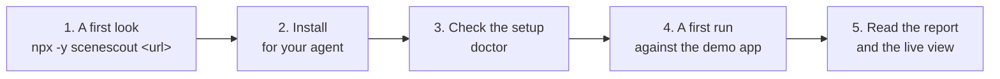
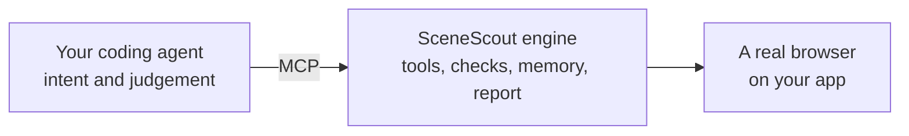
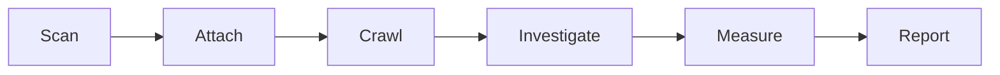
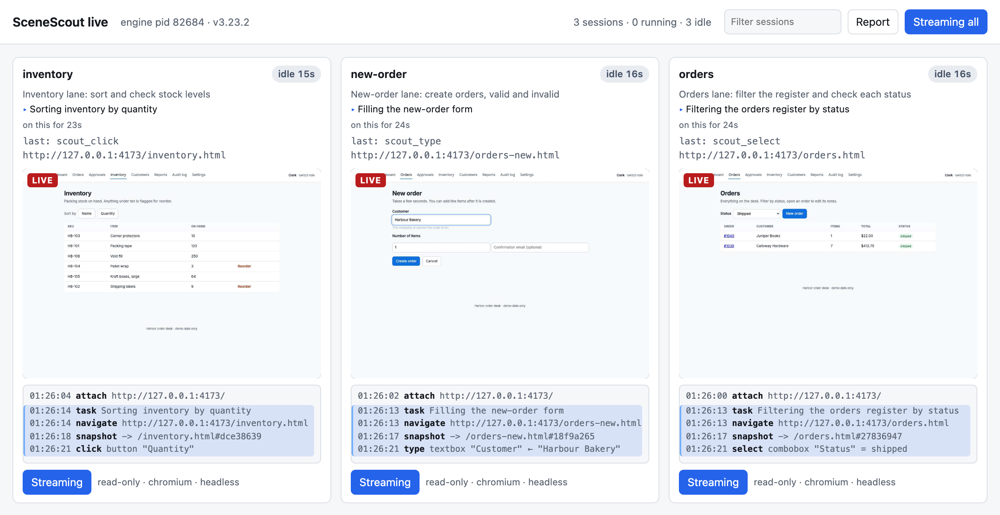

# Start here

> **Who this is for:** anyone trying SceneScout for the first time, developer or not.
>
> **What you will be able to do:** take a first look at an app with one command, install SceneScout for your agent, run it against the demo app, and read the report and the live view.



## A first look, with nothing set up

All it takes is Node 22.19 or newer and the address of an app you are allowed to test, on your machine or deployed:

```bash
npx -y scenescout http://localhost:3000
```

No model, no API key, no MCP client and no setup step. It does three things:

1. **The browser, if it is missing.** It downloads the headless Chromium build once (about 200 MB) and changes nothing else on the machine: no skill, no MCP server registration, no command on your PATH.
2. **A look that sends no form.** It runs in `observe` mode, so only `GET`, `HEAD` and `OPTIONS` requests leave the page, signing in, refreshing a token and any `POST` named as a read in `SCENESCOUT_READ_POSTS` apart. It visits the start page and the pages it finds by following links, up to 20 pages and starting none after 3 minutes, and measures each one by the [check rules](Configuration-reference.md#check-rules): failed requests, uncaught errors, dead ends, controls covered or out of reach, fields with no label, contrast and more. It fills in no form, and reads nothing from the folder it runs in but the [config file](Configuration-reference.md#the-config-file), which can only make it stricter. A link is opened like any page, so a link that changes something just by being opened (an unsubscribe link) would act: point a first look at pages whose links are safe to open.
3. **A report.** It writes `scenescout-report/report.md` (and `check.json`) in the current folder, then prints a summary that opens with the three issues to look at first. It writes only into a `scenescout-report/` that is new, empty or an earlier first look's; any other folder of that name is left alone, and `--out` names another. On the demo app below:

```text
Look at these first:
  1. [medium] Request failed with a client error: GET /img/weekly-chart.png → HTTP 404 (on /)
  2. [medium] Dead end: /reports-scheduled.html: 0 controls (on /reports-scheduled.html)
  3. [medium] Control covered by pinned chrome: button "Save notes" is COVERED by pinned chrome [order-stickybar] at this scroll position — a click aimed at it lands on that element instead (on /order.html?id=1042)

12 pages looked at in 12 s in observe mode: 0 high · 6 medium · 2 low · 5 worth a look, never counted.
Report: scenescout-report/report.md
```

- **Which three come first.** They are chosen by severity, then by how many pages show the issue. One failure seen several ways takes one of the three places: a missing image is a failed request, a broken image and the browser's console line about it. The counts and the report list every issue, the pages it looked at and what it found but did not reach.
- **Exit code.** 0 whatever it finds, because it is a look and not a gate; 2 when the address cannot be reached or the report cannot be written.
- **Going further.** After the address, `--max-routes` and `--max-minutes` raise the limits, and `--mode read-only` lets through the plain POSTs a page sends as it loads ([its options](Configuration-reference.md#scenescout-url)).

A first look only opens pages. Everything below is the full setup: your coding agent drives SceneScout to click, fill forms, compare roles and remember what it learned, and [`scenescout check`](Ways-to-use-it.md#scenescout-check-a-gate-in-ci) gates pull requests with the same measurements.

## What SceneScout is

SceneScout tests a running web app the way an exploratory tester does: it opens pages, clicks, fills forms, compares roles and writes down what is wrong. It does this as an MCP server, so the thinking is done by the coding agent you already use and pay for. The engine itself contains no language model.



What the engine adds to an agent with a browser:

- **A structured view instead of screenshots.** A snapshot lists every element with its role, name, state (pressed, selected, checked, expanded) and layout box, what the page announces in its alert and status regions, and a line on what the main area holds. Overlapping controls, a button pushed off-screen or an image that failed to load are computed from the page, not guessed from pixels.
- **Checks after every action.** Console errors, uncaught exceptions, failed requests and HTTP errors are reported with each tool result, along with checks for a page that contradicts the server (an empty list after a refused request, "Saved" after a refused save).
- **A write policy on the network.** Every request the page sends is judged against the session's write mode, whatever the agent clicks, and a refused one never reaches the server. On a local app the default, `read-only`, refuses `PUT`, `PATCH`, `DELETE` and requests that look destructive, and lets an ordinary form post through, which can create a record or change one. See the [safety model](Safety-model.md) for each mode and what none of them sees.
- **Memory across runs.** Pages, findings and notes are kept in `.scenescout/` in the project, so the next run starts from what the last one learned.
- **A report that says what was not tested.** Its gap ledger lists routes never visited, forms never submitted and pages never audited, and at the `extensive` level the report refuses to finish while any remain.

It finds defects (crashes, dead ends, permission leaks, double submits) and it also reports on quality: contrast, focus, spacing, how many steps a task takes and where users would backtrack.

## Install

You need Node 22.19 or newer, an MCP client, and a web app you are allowed to test.

### With npm (any client)

```bash
npx -y scenescout install                     # Claude Code: skill, MCP server and Chromium
npx -y scenescout install --client cursor     # or vscode, codex, gemini, copilot, windsurf; comma-separated for several
```

`install` downloads the browser (Chromium by default, about 550 MB, once), registers the server with the client you named and puts the `scenescout` command on your PATH. Claude Code also receives the testing method as the `/scenescout` skill; every other client receives the same text from the server through the `scout_playbook` tool and the `explore` prompt. Steps can be skipped with `--no-register`, `--skip-browser` or `--no-command`, and `--browsers` chooses what to download (see [choosing browsers](Configuration-reference.md#scenescout-install)).

### As a Claude Code plugin

```text
/plugin marketplace add brunoboto96/SceneScout
/plugin install scenescout@scenescout-marketplace
```

Then start a new chat to use SceneScout; the test browser downloads on first use (to have it ready beforehand: `npx -y scenescout install --browser-only`). The command becomes `/scenescout:scenescout`. A plugin starts the server at the version the plugin was released with (`npx -y scenescout@<version> serve`), so a new release reaches you only when you update the plugin: `/plugin marketplace update scenescout-marketplace`. To follow the latest npm release instead, register the server by hand with `npx -y scenescout serve`; the plugin has no setting for this, because a plugin option substituted into the server arguments is not yet a documented, tested route. If a plugin or a registration pins a version npm does not have (a release whose publish has not finished), `scenescout doctor` says so.

An optional second plugin, `scenescout-mod`, adds a guided panel and a model setting for lane agents in the Claude Code CLI and the desktop Code tab: [The Claude Code mod](Ways-to-use-it.md#the-claude-code-mod).

### Without writing prompts: the guided panel

If you would rather press buttons than write instructions, install the optional mod as well:

```text
/plugin install scenescout-mod@scenescout-marketplace
```

Then type `/scenescout-guided` in the Claude Code CLI or the Code tab of the Claude Desktop app. Press **Check a site**, type the address, tick what to check, choose how careful to be (*Look only* is the default and is safe on a live site) and press **Start**. The panel shows what it is doing in plain words while it runs, and at the end lists each problem with its steps, what was expected and what happened. Nothing that writes to your site starts without a confirmation that only you can give. [What the panel does, step by step](Ways-to-use-it.md#the-claude-code-mod).

### As a Claude Desktop extension

Download `scenescout-X.Y.Z.mcpb` from the [latest release](https://github.com/brunoboto96/SceneScout/releases/latest) and open it, or in Claude Desktop choose Settings > Extensions > Advanced settings > Install Extension and pick the file. It is ready as soon as it is installed: start a new chat and ask *"Use SceneScout to test http://localhost:3000"*. Tell it which folder to keep its notes and report in, for example a new folder in Documents.

To start without writing a prompt, pick **Check my site** from the extension's prompts in the chat: a short form asks for the address, what to check and how careful to be (*Look only*, the default, is safe on a live site), and the check ends with each problem as a card. **Is it safe to run on my live site?** answers that question first, in the same words as the guided panel. [All five guided prompts](Ways-to-use-it.md#guided-prompts-in-the-chat).

The extension carries the engine, and the test browser downloads on first use: the first test says "Getting the test browser ready", downloads it once (about 200 MB) and carries on. No terminal step is needed. If the download fails, SceneScout says why and gives the command to run by hand, `npx -y scenescout install --browser-only`. `npx -y scenescout doctor` recognises the extension and checks it.

### What `install --client` does for each client

| `--client` | How it is registered |
|---|---|
| `claude-code` (default) | `claude mcp add`, plus the skill |
| `cursor` | adds an entry to `~/.cursor/mcp.json`, keeping the others |
| `vscode` | VS Code's own `code` command line; a `code` command that belongs to another editor is not used |
| `codex` | `codex mcp add` |
| `gemini` | `gemini mcp add --scope user` |
| `copilot` | `copilot mcp add` (GitHub Copilot CLI) |
| `windsurf` | adds an entry to `~/.codeium/windsurf/mcp_config.json`, keeping the others |

A configuration file that is not valid JSON is left untouched, and the entry to add by hand is printed instead; one that is a link into a dotfiles repository is written through the link. When a client that registers through its own command is not installed, `install` says so and prints the command to run later; on Windows, a client installed through npm is a `.cmd` shim `install` cannot start, so it prints the command too. Restart the client afterwards.

Registering through each command above has been run against Codex CLI, Gemini CLI, GitHub Copilot CLI and VS Code, and Cursor's command line agent has read the entry `install` wrote, connected and listed the tools. The Windsurf path follows its documentation. If a client behaves differently for you, a correction is welcome; say which client version you checked.

### A client that `install` does not know

Add a stdio server to the client's configuration whose command is `npx -y scenescout@3.34.1 serve`. Most clients accept this shape (the first test downloads the browser it drives, once; `npx -y scenescout install --browser-only` does it beforehand):

```json
{
  "mcpServers": {
    "scenescout": { "command": "npx", "args": ["-y", "scenescout@3.34.1", "serve"] }
  }
}
```

That is the entry for Cursor (`~/.cursor/mcp.json`, or `.cursor/mcp.json` in a project), Gemini CLI (`~/.gemini/settings.json`, or `.gemini/settings.json` in a project), Windsurf (`~/.codeium/windsurf/mcp_config.json`) and Cline (MCP Servers > Configure, or `~/.cline/mcp.json` for its CLI). The others differ:

<details>
<summary><strong>VS Code</strong> (Copilot agent mode): <code>.vscode/mcp.json</code></summary>

```json
{
  "servers": {
    "scenescout": { "type": "stdio", "command": "npx", "args": ["-y", "scenescout@3.34.1", "serve"] }
  }
}
```

</details>

<details>
<summary><strong>Codex CLI</strong>: <code>~/.codex/config.toml</code></summary>

```toml
[mcp_servers.scenescout]
command = "npx"
args = ["-y", "scenescout@3.34.1", "serve"]
```

</details>

<details>
<summary><strong>Zed</strong>: <code>settings.json</code> (command palette: <code>zed: open settings file</code>)</summary>

```json
{
  "context_servers": {
    "scenescout": { "command": "npx", "args": ["-y", "scenescout@3.34.1", "serve"], "env": {} }
  }
}
```

</details>

The entries above name the release this guide was published with, so a client starts the server you read about and never a newer one by surprise. To move to a later release, change the version in the entry. To follow the newest release on every launch instead, leave the `@<version>` part out of the entry (`scenescout` alone); `npx` then runs whatever npm calls latest, which can change between two starts. `scenescout install` registers the version it ran from, and the Claude Code plugin starts the version it was released with; a plugin update picks up a new stable release once it is on npm, because the marketplace reads the plugin from the major version's tag (such as `v3`), which moves only after publishing, rather than from the main branch.

Every client gets the testing method from the server itself: its instructions tell the agent to call `scout_playbook` before the first attach, and a client that lists server prompts as commands also has an `explore` prompt. So *"Use SceneScout to test http://localhost:3000"* is enough as a first message.

### Check the setup

```bash
npx -y scenescout doctor            # Claude Code: node, build, browser, skill, registration
npx -y scenescout doctor --engine   # any other client: node, build, browser
```

Every line should be a tick; any other line prints the command that fixes it. With the Claude Desktop extension installed, `doctor` also checks the extension, and does not ask for the Claude Code skill or registration unless you have set those up too. Then start a new chat in your client.

## A first run against the demo app

The repository ships a small order-desk app with defects planted on purpose. It needs no dependencies:

```bash
git clone https://github.com/brunoboto96/SceneScout.git
cd SceneScout
npm run demo:serve         # http://127.0.0.1:4173
```

It has three roles, picked on its sign-in page: a clerk who takes orders, a manager who approves them and an auditor who only reads. The [demo app's README](../../demo-app/README.md) lists every planted defect; read it after your run if you want to see what was missed.

In a second terminal, open your agent in the cloned folder and ask:

```text
Use SceneScout to test http://127.0.0.1:4173 at medium level
```

In Claude Code the skill also gives a command:

```text
/scenescout --level medium --url http://127.0.0.1:4173
```

What happens next, in order:



1. **Scan.** `scout_scan` reads the project: framework, routes found in the source, saved logins. The demo is plain HTML, so it finds no framework and the route list is built from links instead.
2. **Attach.** `scout_attach` opens a browser in a write mode (`read-only` for a local app). Its result has a `Live view:` line with an address; the agent passes it on to you.
3. **Crawl.** `scout_crawl` visits every known route in one call and reports each one's status, element count and problems. A route that landed on another page is marked `REDIRECTED`, and a path crawled by name that answers as a page joins the route list.
4. **Investigate.** The agent follows up on what the crawl flagged: it navigates, snapshots, reproduces, and files each defect with `scout_finding`.
5. **Measure.** `scout_design_audit` scores representative pages; `scout_journey` measures how many steps a task takes, how long it took while being worked on (pauses over 30 seconds are left out and counted), and whether the user had to backtrack.
6. **Report.** `scout_report` checks the level's contract and writes `.scenescout/report.md`.

A `medium` run is sized at around 150 actions. On the demo it typically finds the 500 behind the Archived filter, the badge covering a button, the double-click that creates two orders and the approve endpoint that accepts a clerk, among others; how many of the planted defects a run finds varies from run to run, which is what [Measuring it](Measuring-it.md) is about.

## Levels

The level is a contract that `scout_report` enforces for what the engine can see, and the gap ledger discloses the rest.

| Level | What it asks for | Rough size |
|---|---|---|
| `minimal` | Every route visited, at least one design audit, the main journeys walked, problems from the crawl triaged | about 40 actions |
| `medium` (default) | minimal, plus design audits across several routes, every kind of control exercised and every form submitted valid and invalid | about 150 actions |
| `extensive` | medium, plus fuzzing, back and refresh resilience, a keyboard-only pass, a journey per module, two or more roles compared and the signed-out pages walked. The report refuses to finish while the gap ledger has entries | capped by budget |

## Reading the report

`.scenescout/report.md` and `report.html` are laid out for whoever reads them first, in this order ([why](../adr/0031-the-report-opens-with-a-summary-and-folds-the-technical-details.md)):

1. **Summary**, in plain words, for anyone who does not read request signatures. It opens with one paragraph: which site was checked, when, for how long and with which care level, and what was found. Then the problems as a table, worst first: the impact (blocks users, annoying or cosmetic), the problem, where it was, what you would see and what was expected. Then each problem folded under its number and title: the steps that led to it, what was expected and what happened. Its id, category, severity, the evidence signature and route are folded once more inside it, under **Details for developers**.
2. **Evidence**, only when a problem has a picture or the run was recorded: each problem's picture beside its number and title, with the frames recorded before it was filed.
3. **Technical details**, folded: everything for the developer who fixes it ([the technical report](#the-technical-report)).
4. **Steps**, folded, in `report.html` only: every action each session took.

`report.html` opens from the file, offline, on a phone, in dark mode and in print, and loads nothing from outside the file. A Markdown viewer that does not fold `<details>` shows every part unfolded.

Text that came from the app (titles, steps, details, addresses, ticket text) is written into `report.md` inert: on one line where a line break would start a heading or end a table cell, and with Markdown and HTML escaped, so a link, an image, a heading or a fold tag in it shows as text and loads nothing wherever the Markdown is pasted. A web address in it is text too, not a link; the page each problem is on stays a link. `report.html` and the live view read it back as the app wrote it. The team report's Markdown, the check's report and the CI run's summary are written the same way.

When the run was given tickets, the Summary answers them after the problems table: for each ticket, every acceptance criterion as passed, failed or not tested. A failed criterion names the problems that show it; one not tested says why (the account used could not reach it, the run was only allowed to look, or it was outside what the run could check). A verdict the agent was not sure of is marked unsure.

### The team report

When the report is for other people, ask for the team report: say "make a team report", pick *Make a team report* in the chat's prompt menu, or press **Make a team report** on the guided panel's results. `scout_team_report` writes, inside `.scenescout/` and nowhere else:

- `team-report.html`, one page that opens in any browser and prints cleanly: a cover (the site, the date, what was checked, the care level and how thorough), the plain summary, each problem this check found as a card with its picture, the ones marked "not a bug" listed apart, what the check did not test (the gap ledger) and blank lines for who checked, reviewed and approved it;
- `team-report/`, the evidence folder beside it: the pictures, the same report as `report.md`, and `manifest.json` with every file's SHA-256, the SceneScout version and the check's times. The page lists the hashes of the pictures and the Markdown, so a reader can tell the files are the ones the report was made with.

Making it again replaces the last team report, and removes only the evidence files the last one listed. Nothing is sent anywhere. The layout is built in for now: a template like `scenescout check --template` uses for a recorded check is not read for it.

`scout_report {report}` chooses which parts a report carries: `both` (default) all four, `qa` the Summary and the Evidence alone (the unchecked parts are then listed in the Summary), `dev` the technical report alone, unfolded. It applies to the files `scout_report` writes; the live view's report always shows both.

### Filing problems as tickets

To put problems where the team works, say "file these as tickets", pick *File problems as tickets* in the chat's prompt menu, or press **File as tickets** on the guided panel's results. Claude asks which problems and where (a GitHub repository, or a Jira project), and `scout_ticket_preview` shows what would happen: each ticket it would file, the ones already filed, and any over the limit of one filing (20), which wait for the next. Nothing is sent yet.

When you want them filed, `scout_ticket_file` shows you SceneScout's own form listing the tickets, and files them only if you say yes there. Claude can ask for that form but cannot answer it, so text on the site under test cannot talk it into filing. A preview lasts 10 minutes and is used once; if one of its problems is found again or changes after it was made, nothing is filed until you make a new preview. Each ticket's link comes back once it is filed. The tickets are the same ones [`scenescout export`](Ways-to-use-it.md#filing-findings-as-issues) files, with the same marker, so neither files a problem twice.

The tracker's sign-in is set up once, where whoever installed SceneScout keeps settings: the desktop extension's settings in Claude Desktop, or the environment Claude Code starts in ([Desktop extension settings](Configuration-reference.md#desktop-extension-settings)). It is never typed into the chat, and never shown in a result.

### The technical report

It is the **Technical details** part, folded under the Summary and the Evidence (and the whole report with `report: 'dev'`):

| Section | What it tells you |
|---|---|
| **Run metrics** | Open findings, route coverage, design audits, oracle violations, and how many errors the write policy itself caused (these are not counted as the app's) |
| **Acceptance criteria** | On a run given tickets, each criterion's verdict with the confidence the agent stated, the ids of the findings it linked, its reason and the sessions that judged it |
| **Page quality scores** | 0 to 100 per audited route, for accessibility, craft, consistency and task clarity, worst first, with the two largest deductions behind each; from four audited pages, each is also scored against the others, and a section lists the values only one page uses |
| **Gap ledger** | What was not tested. Treat it as the honest limit of the run, not as noise |
| **Findings** | Each with a severity, category, the evidence as a machine signature (`GET /api/orders?status=archived → HTTP 500`), where it happened, a repro trace of the last actions and a Playwright regression-test skeleton |
| **Worth a look** | Observations that are defects only under a convention the run cannot see, such as a 4px spacing scale. They are listed and never counted as defects |
| **Role capability matrix** | Which role could reach what, on a run with more than one role |
| **Pace and lane calibration** | On a parallel run, how the time was spent and whether each lane's stated confidence matched what was filed |

[examples/report.md](../../examples/report.md) is a complete report from the demo app.

### A picture of each finding

Each finding is filed with a picture of what it is about: the element the agent names, with a margin around it, or the page as it was. The picture is kept in `.scenescout/recordings/`, shown under the finding in `.scenescout/report.html`, and returned with the agent's `scout_finding` result, so a chat client shows the evidence as it is filed. Pictures are held to 800 pixels on their longer side and 200 KB, and a session returns the first 10 in the conversation; later ones are kept and in the report. `scout_attach {evidence: "file"}` keeps them out of the conversation, `{evidence: "off"}` takes none, and a CI job keeps them on file by default. The [configuration reference](Configuration-reference.md#environment-variables) has the settings. A picture shows whatever the page showed, and the engine's secret redaction reads text, not pixels: on a page that displays secrets, turn pictures off.

### What the next run remembers

Findings stay in `.scenescout/memory.json`. The next run skips states already covered, deduplicates findings on their evidence and lists older findings as an index; `scout_report {history: "full"}` prints every one in full. `.scenescout/` writes its own `.gitignore`, so a `git add -A` in the project does not pick it up.

## The live view

Every attach starts a small local page that shows each session: the tool it is running and for how long, the page it is on as a thumbnail, and a feed of what it just did. A call stuck past its time budget turns its card red. The report button shows the report as it stands mid-run.

A session's close-up has a timeline of its steps. Clicking a step shows the page as it was after it, on every run: the live view holds a frame of each of the last 100 steps per session in memory (at most 12 MB a session), never on disk, and drops them when the session closes. Large pictures (a very wide viewport, say) fill that bound in fewer steps. A step whose frame is no longer held says so; a recorded run keeps every frame on disk instead ([Recording a run](#recording-a-run)). Taking these frames adds a few tens of milliseconds to each step.



```bash
scenescout watch            # open the live view for the project in this folder
scenescout status           # the same information as text
```

### In the conversation

Ask the agent how the run is going and it calls `scout_status`. In a client that renders MCP Apps, that puts a small pane in the conversation which refreshes itself every few seconds: each session's objective and task, open findings by severity, coverage, and a button that opens the live view. It shows nothing the live view does not, and loads nothing from outside. A client without MCP Apps gets the same as text, starting with the live view's address.

In a guided check the pane also follows the check in plain words: one sentence for what is happening now and the few before it, each area you chose (waiting, checking, done or skipped), pages checked and time used against the plan's limits, problems so far by how much they matter, and the newest problems as cards with **Not a bug**, **Explain more** and **Check again**. It also shows roughly how much clicking the check saved you, always with what that figure is based on; the rates behind it are a rough default, not a measurement, and the figure never goes into a report. Where the client cannot take a message from the pane, **Explain more** and **Check again** show the words to say to the agent instead.

### Who can reach it

The page is served on `127.0.0.1` only, behind a token that changes on each start, and answers `GET` and nothing else. No frame it shows is written to disk. `SCENESCOUT_LIVE=off` in the server's environment keeps it closed.

A client that lists the server's prompts has `live`. It takes no arguments and no password: the agent returns the loopback address already printed in a tool result, and may open it where the host can open a URL.

### When it opens by itself

On a desktop, the engine also opens the live view in your default browser as a session attaches, and the report when `scout_report` writes it, whether or not the browser window is shown. In CI, over SSH, or on Linux with no display, nothing opens. To choose yourself, set `SCENESCOUT_OPEN` to `live`, `report`, `both` or `none` in the server's environment (`none` if you want no tabs), or ask the agent (`scout_attach {open: "none"}`). Set that way, the live view opens once per server, so a run of many sessions opens one tab; an attach that asks for it itself (`scout_attach {open: "live"}`) opens it every time, or says why it could not. The agent can ask for less than the server's setting, never more: with `SCENESCOUT_OPEN=none`, or in CI, over SSH or with no display while it is unset, its `open` is refused and the attach says so. Opening the page changes nothing about who can reach it.

### Recording a run

To keep a copy of the whole run, ask for a recording (`Use SceneScout to test … and record the run`, or `scout_attach {record: true}`). The engine then keeps a frame after every action, and `.scenescout/report.html`, the self-contained page `scout_report` writes beside the report, shows the screenshots around each finding and each session's trail. Recording is off by default because frames are pictures of the app: secret fields are painted over in them, but the engine's text redaction cannot read anything else a frame shows ([what is masked in pictures](Safety-model.md#what-is-written-to-disk)). A team that wants every QA run recorded sets `SCENESCOUT_RECORD=on` in the server's environment once.

## Next

- Test your own app: [Ways to use it](Ways-to-use-it.md), then the [recipe](Recipes.md) closest to your project.
- If your app needs a sign-in: [Signing in](Signing-in.md).
- Before pointing it at anything with real data: [Safety model](Safety-model.md).
